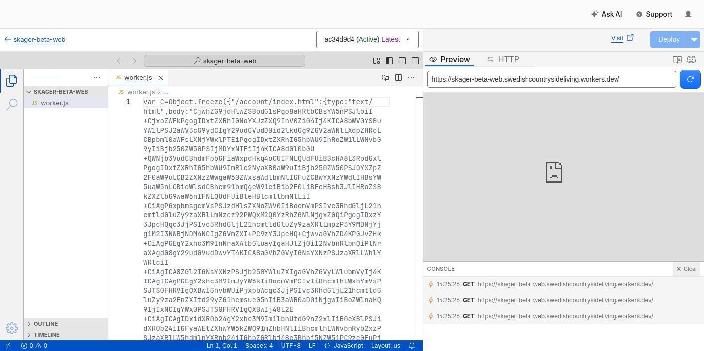
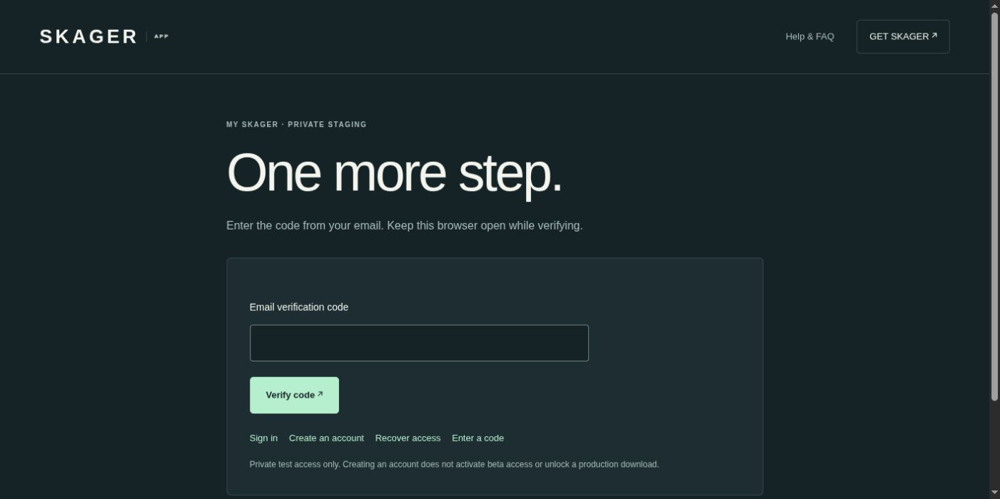

# Private frontend publication — 2026-10-14

Scope: SCRUM-40/43, invited SKAGER beta at `https://beta.skager.app`.
This is deployment and unauthenticated UI evidence, not completed login,
commerce, download, or public-launch acceptance.

## Exact candidate and activation

- Frontend source: `8a7adc9c923b5aad61fcd8ea9306b52e7cb29dde`.
- [Web CI 38553897564](https://github.com/ThereptileII/Work/actions/runs/38553897564)
  passed 204 tests (88 Django, 116 Edge), plus disposable SQL checks.
- Retained `worker.js` / `cloudflare-upload.js`: 504,268 bytes, SHA-256
  `a42d54ba857209cc76cee87a66905ad34502e5d80fc79d1091e3c27931427f0e`.
- Owner completed the supported whole-file drag/drop into the Cloudflare
  `skager-beta-web` editor. The agent then selected Deploy once. The click's
  transport timed out, so it was not repeated; fresh dashboard state confirmed
  **`ac34d9d4 (Active) Latest`**, with Deploy disabled.
- This was not a partial editor paste. No independent full provider-source byte
  readback was available; the retained upload hash is not represented as a
  provider-readback hash.
- Supabase server remains the earlier deployed source
  `af986f7416bebb638c0e59dfbf98e58732a21157`. The candidate server SHA-256 is
  `09d1de0db9a9ea8ac3cae2b2fec42195ca9f85fd32c533b1fa14b6cfbf113a61`,
  byte-identical to that deployment; no server replacement or SQL change occurred.

The dashboard preview uses the alternate workers.dev origin, which is not the
supported product origin; its failed preview is not the beta-origin result.

## Observed live UI

The beta-origin homepage renders the SKAGER experience, explicit illustrative
chart labels, separate OpenCPN prerequisite and public-access-closed statement.
Login navigates to `/auth/login/`, renders the email form, and the authorized
owner sign-in request reaches the neutral eligible-request success message.
`/auth/verify/` then renders an empty code field and Verify code button. No code,
session credential, email body or private account data is captured here. The
owner has not yet completed code entry; no signed-in session is accepted.

### First invitation versus returning-user login

The neutral login result above did **not** prove delivery. The provider Auth
log at `2026-10-14T15:49:57Z` reports `/otp`, HTTP 422,
`signup_disabled`. The authorized test account exists but has not confirmed its
email. Supabase's ordinary OTP flow treats an unconfirmed account as signup;
public signup correctly remains disabled. No authentication gate was weakened.

The existing website **Create an account** (`/auth/signup/`) flow was then used
for that same allowlisted address. This invokes the server-side invitation path
and creates the application's verification challenge. Resend's sending list
confirmed a new **delivered** `Your SKAGER account code` message. Only delivery
metadata was inspected; the email body and code were not opened or captured.
The owner is left at the empty code form in the same browser and must use the
newest invitation. The earlier provider-dashboard invitation alone did not create
an application challenge. No credential or backend deployment changed.

This behavior agrees with the official Supabase Auth
[MagicLink](https://github.com/supabase/auth/blob/master/internal/api/magic_link.go),
[signup](https://github.com/supabase/auth/blob/master/internal/api/signup.go),
[invite](https://github.com/supabase/auth/blob/master/internal/api/invite.go) and
[verification](https://github.com/supabase/auth/blob/master/internal/api/verify.go)
implementation; the observed provider error and delivered invitation are the
live evidence, not an assumption about the hosted source revision. Successful
code verification and an authenticated session remain pending.

Browser navigation to `/preview-provenance.json` and `/api/health` returned
`ERR_BLOCKED_BY_CLIENT`; neither produced a service response in this check.
No protection was disabled and these attempts are not classified as a backend
failure or a successful health/provenance readback.

## Separate credential and R2 state

The owner completed Stripe TEST secret/webhook storage; provider metadata showed
distinct digests. The dedicated endpoint is Active with the previously approved
five test checkout/refund event types. The configured SMTP path delivered the
earlier authorized invitation according to Resend. These observations do not
prove this later login email, webhook signature verification or settlement.

The existing R2 diagnostic invocation remains 401 before R2 I/O. Its gateway
metadata reports HS256/service_role, but this does not establish equality with
the injected binding. Exact retained probe bytes also pass offline Node and Deno
checks with synthetic credentials; no justified source bug was found. No R2
credential was rotated and no authentication comparison was weakened.

At that checkpoint, code verification and all commerce/download acceptance were
pending. The later observation below supersedes only the explicitly verified
parts; the earlier failed attempts remain evidence.

## Owner verification and private portal follow-up

The first application challenge expired before the owner entered its code. A
fresh invitation was sent through the actual website and Resend confirmed
delivery. The owner then entered the new code and reported success. Live DOM
readback confirms the authenticated portal and Sign out control. Only delivery
metadata and the credential-free portal were inspected; no OTP/email body was
read. The private portal screenshot is retained outside Git.

`PORTAL_ENABLED=true` was saved at 16:27:49 UTC, and the private TEST checkout
flag at 16:28:54 UTC. Both flag digests were read back. Exact owner allowlisting,
global signup OFF, email confirmation, session/CSRF checks and closed downloads
remain unchanged. The portal correctly has no orders and no active entitlement.

Entering approved `SKAGERFRIENDS` and choosing Continue to test checkout returns
the exact `Unavailable` status. The deployed handler returns this generic 404
only when configuration validation fails, before account/provider I/O. Known
nonsecret configuration digests match the exact expected return origin, price,
coupon and promotion IDs. No Stripe request, order or entitlement is inferred.
Remaining credential-shape/runtime configuration diagnosis must not disclose
values or relax validation. No new secret or provider key was created.

Pending: returning-user recovery/logout checks, TEST checkout/100% coupon,
verified webhook/entitlement/refund, cross-account access, authenticated R2
read/download/expiry and desktop release qualification. Public signup, payments
and downloads remain closed pending separate readiness review and explicit GO.
